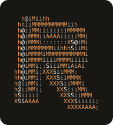
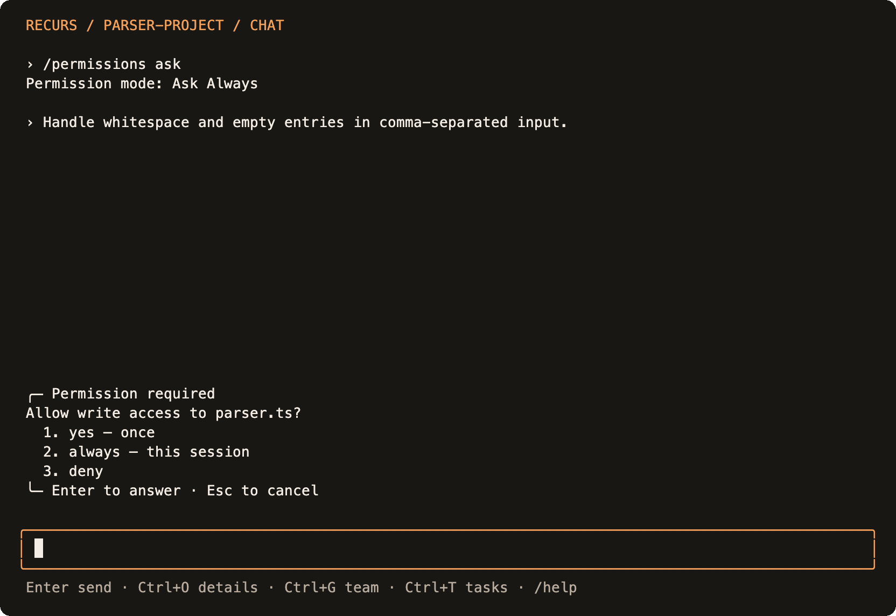
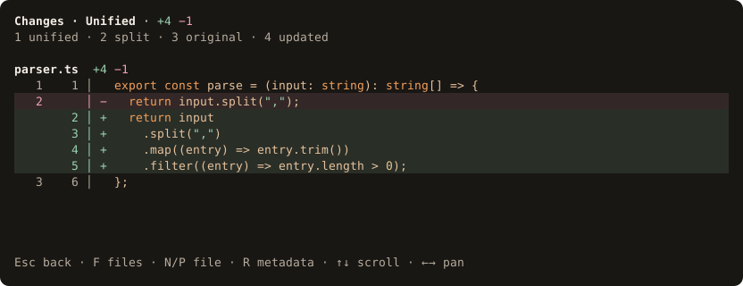
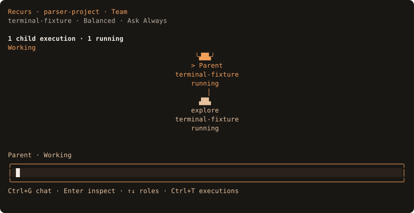

<p align="center">
  
</p>

<h1 align="center">Coding agents. Your terminal.</h1>

<p align="center">Choose the models. Bound the team. Review every change.</p>

<p align="center">
  <a href="https://github.com/tacotuesday8888/recurs/actions/workflows/ci.yml"></a>
  <a href="https://www.npmjs.com/package/recurs"></a>
  <a href="LICENSE"></a>
</p>

<p align="center">
  <a href="https://tacotuesday8888.github.io/recurs/#first-session">Try the first-session guide</a> ·
  <a href="#every-step-stays-in-view">Watch the terminal walkthrough</a> ·
  <a href="docs/CLI.md">CLI guide</a>
</p>

## Install

Use a terminal in your Git project on macOS or Linux. Recurs requires Node.js
22.22+, Git 2.45+, and ripgrep. Linux also needs Bubblewrap for subprocess tools.

```bash
npm install --global recurs@alpha
```

<details>
<summary>Bun, Homebrew, or the release installer</summary>

Choose one installation method.

```bash
bun install --global recurs@alpha
```

```bash
brew install tacotuesday8888/recurs/recurs
```

```bash
curl -fsSL https://github.com/tacotuesday8888/recurs/releases/download/v0.1.0-alpha.11/install.sh | sh
```

Bun can install Recurs; Node.js runs it. [Install help](docs/CLI.md#install)

</details>

## Your first chat

Start Ollama or LM Studio with a local model that supports tool calls. From
your project directory, open Recurs.

```bash
recurs
```

Choose **Start new chat**, select **Use detected Ollama** or **Use detected LM
Studio**, and enter the exact model ID shown by your server. Choose **Ask
Always** for permissions, then **Start coding**. If your server uses a custom
port, pass its loopback URL and model ID to `recurs setup local`.
[First-run guide](docs/CLI.md#first-run)

The published `0.1.0-alpha.11` works with local models. Its hosted reviews
expired in October 2026. The `0.1.0-alpha.12` source candidate renews nine
hosted routes, including Codex with ChatGPT, Copilot, and the OpenAI,
Anthropic and Gemini APIs. [Provider matrix](docs/PROVIDER_CAPABILITY_MATRIX.md)

Send this in the chat to explore your project in read-only Plan mode.

```text
/plan Trace one feature from its entry point to a test. Include file paths.
```

Open the files it names or ask a follow-up. When you're ready to make a change,
send `/plan exit` and describe the edit. To pick up later, run `recurs` in the
same project and select your saved chat. In the alpha.12 candidate,
`recurs --continue` reopens your most recent active chat and `/` on the home
screen searches active and archived chats.

## Every step stays in view

When you delegate implementation, workers edit isolated Git worktrees. An
independent reviewer checks the changes before your session applies them.



| In the terminal | What you can do |
| --- | --- |
| `/agents routes` | See which models are assigned to implement, review, and repair. Run `recurs setup` from your shell to change assignments. |
| `/agents controls` | Inspect delegation depth, concurrency, and request limits before starting a team. |
| <kbd>Ctrl</kbd> + <kbd>T</kbd> | Select a worker and press <kbd>Enter</kbd> to inspect its transcript and changed files. |
| `/diff` | Review changes in your working tree. Use `/diff --staged` for the staged patch. |

<details>
<summary>Code review and the agent team</summary>





</details>

## Built to stay responsive

| Recurs, same workload | Before | After |
| --- | --- | --- |
| Streaming turn, median over 120 turns | 501–521 ms | **124 ms** |
| Loading a chat's agent history beside 30 other chats | 1.1 s | **8 ms** |
| Peak physical memory over 120 turns | ~400 MiB | **~270 MiB** |

Against one local model server with identical replies, Recurs finished a long
streamed answer in **369 ms**, against 432 ms for Codex CLI and 495 ms for
Claude Code (median of five runs; one of three measured workloads).
[CLI comparison](benchmarks/cli-resources/README.md) ·
[Memory method](docs/ACTIVE_SESSION_MEMORY.md)

## Reference

[CLI](docs/CLI.md) · [MCP](docs/MCP.md) · [Skills](docs/SKILLS.md) ·
[Appearance](docs/APPEARANCE.md) · [Benchmarks](benchmarks/product-comparison/README.md) ·
[Contributing](CONTRIBUTING.md)

This source describes `0.1.0-alpha.12`. Install the public preview with the
`@alpha` tag. The [public alpha status](docs/PUBLIC_ALPHA.md) lists the verified
package and installation channels. Captures come from the installed terminal.
[Release notes](CHANGELOG.md) · [Feature status](docs/FEATURE_STATUS.md) ·
[Verification](docs/UI_VERIFICATION.md) · [Security](SECURITY.md) · [Privacy](PRIVACY.md)
